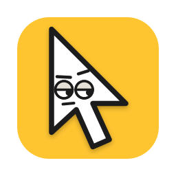
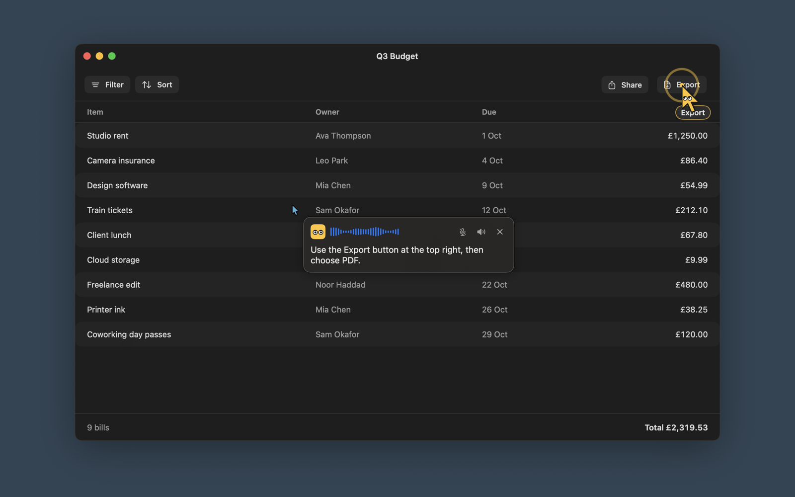
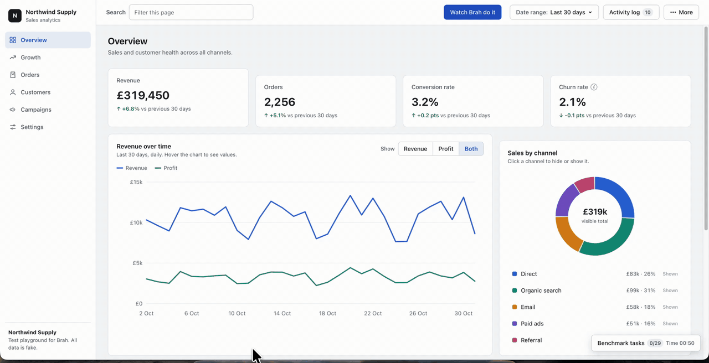
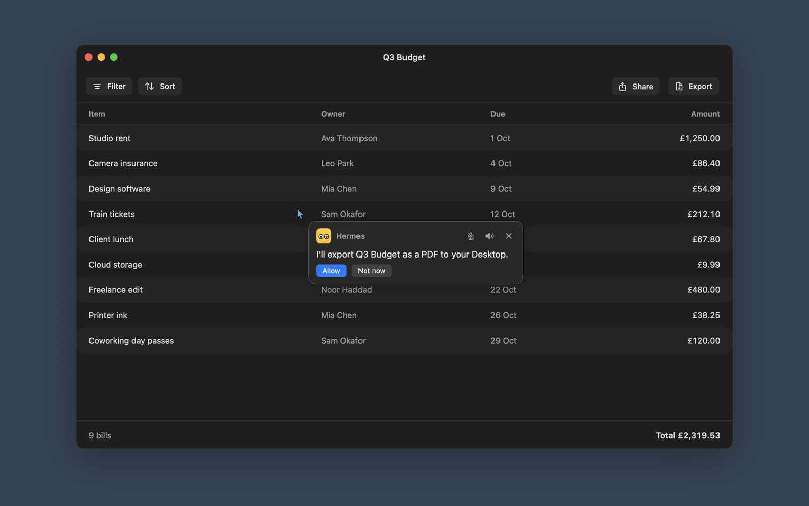

<h1 align="center">Brah: a voice AI assistant for your Mac that sees your screen</h1>

  Ask about anything on your screen. Brah answers out loud and points at the thing with its own cursor. 
  Ask it to do the job, and it clicks and types for you.

  <a href="https://github.com/rezaulhreza/brah-releases/releases/latest/download/Brah.dmg"><b>Download Brah for macOS</b></a>
  &nbsp;·&nbsp;
  <a href="https://brah.ferrolo.com">Website</a>
  &nbsp;·&nbsp;
  <a href="https://brah.ferrolo.com/media/promo.mp4">Watch the 57-second film</a>
  &nbsp;·&nbsp;
  <a href="https://github.com/rezaulhreza/brah-releases/releases">All versions</a>

  
  
  
  

Free for 7 days. No account, no card.

## What Brah does

Hold a key or say **"Hey Brah"**, then ask. Brah takes a picture of the screen under your cursor
and sends it, with your question, to the AI you choose. You hear the answer, and you see it.

- **Points at the answer.** A yellow Brah cursor flies to the exact button, menu or cell and shows
  a label. No more "top right. No, the other top right."
- **Marks the screen.** Circles, boxes, arrows and lines, drawn in one by one, like a mate at a
  whiteboard.
- **Guides you step by step.** Ask how to do something. Brah points at the first click and waits.
  You click, Brah looks again and points at the next one, until the job is done.
- **Does it for you.** Ask Brah to do the job, and it clicks and types. It checks with you before
  anything risky, such as send, pay or delete. Stop ends the task at once.
- **Draws live 3D scenes.** Ask "show me how a bike's gears turn the wheel" and Brah draws a scene
  that moves while it talks. Turn it, change it, save it as a picture or a 3D file.
- **Hands-free.** Say "Hey Brah" and talk. The wake word is heard on your Mac, and no audio leaves
  it until you say it.
- **Keeps your conversations.** Pick one up later in Brah, or go on in Claude Code or Hermes.

## Works with the AI you already have

Brah does the seeing, listening, talking and pointing. Your AI does the thinking. No new AI
subscription.

| Your AI | Answers and points | Clicks and types for you |
|---|---|---|
| Claude subscription (through Claude Code) | Yes | Yes |
| ChatGPT subscription | Yes | Yes |
| Anthropic API key | Yes | Yes |
| Hermes | Yes | Yes, with its own tools |
| Ollama, LM Studio or any OpenAI-compatible server | Yes | No: it points, you click |

Use a local model with Ollama or LM Studio, and your screen and questions stay on your Mac.

## Watch it work

Brah works through six tasks on a made-up dashboard, then stops to ask before it sends an invoice.
Recorded at 2x speed with no sound. In real use, Brah says each step out loud.

## Install

1. [Download Brah.dmg](https://github.com/rezaulhreza/brah-releases/releases/latest/download/Brah.dmg).
2. Open the DMG and drag Brah to Applications.
3. Open Brah. The welcome guide asks for the microphone and Screen Recording permissions and helps
   you pick your AI.

Brah is signed with an Apple Developer ID and notarised by Apple. It runs on macOS 14 Sonoma or
later, on Apple silicon and Intel Macs. Installed copies update themselves.

## Price

Free for 7 days, with every feature. Then [buy a licence](https://brah.ferrolo.com/buy): **$29
once**, with a year of updates. The version you have is yours to keep. No subscription.

## Privacy

- Brah sends your screen and your question only to the AI you choose.
- Brah does not save your screenshots.
- Your keys and sign-ins stay in your Mac's Keychain.
- Brah can hear you on the Mac, with no audio sent anywhere.

The full detail: [privacy policy](https://brah.ferrolo.com/privacy) and
[security](https://brah.ferrolo.com/security).

## Questions

**Is Brah a ChatGPT or Claude app?** No. Brah is a separate Mac app that uses the Claude, ChatGPT,
Hermes or local model you already have.

**Can Brah send, pay or delete without asking?** In Auto mode, Brah asks before risky steps like
those. These safeguards lower the risk, but we cannot guarantee them: the AI can get a step
wrong. Watch what Brah does, and press Stop if something looks wrong.

**Can my screen stay on my Mac?** Yes. Use a local model in Ollama or LM Studio, and set hearing to
This Mac. Only the spoken answer goes to the voice service you pick, as text.

**Why "Brah"?** Say it *brah*, as in "ho, brah!". **Bruh** is the face you make when the Export
button was right there all along. **Brah** is the mate who points at it.

## Problems and ideas

- [Report a problem](https://github.com/rezaulhreza/brah-releases/issues/new?template=bug.yml)
- [Suggest a feature](https://github.com/rezaulhreza/brah-releases/issues/new?template=feature.yml)
- Security issue: do not open an issue. See the [security policy](https://brah.ferrolo.com/security).

Licence, payment or refund: email brah@ferrolo.com. Lost your key?
[Find it](https://brah.ferrolo.com/find-key). Never post a key here.

This repository holds Brah's release files. Brah itself is closed source.
